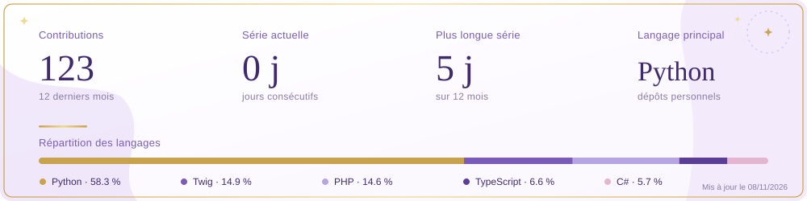

 

 Profil hybride à la croisée du <strong>développement logiciel</strong> et de l'<strong>intelligence artificielle</strong>, avec un intérêt particulier pour la conception d'<strong>applications full-stack</strong>, les <strong>systèmes intelligents</strong> et les technologies web modernes. 

 

 

 

 

 

 

 

 

 

 

- Développement **fullstack** d'une **application mobile de coaching sportif** (`Next.js`, `React`/`Ionic`/`Capacitor`, `Prisma`, `PostgreSQL`)
- Développement d'un **assistant intelligent** pour la génération de **séances personnalisées**
- **Fiabilisation des recommandations** par matching des exercices et gestion des quotas
- **Refactoring** de l'architecture pour améliorer sa **modularité** et son **évolutivité**

 

- Contribution au développement d'une **solution d'assistance interne** permettant d'exploiter des données provenant de différentes sources (`Jira`, `Confluence`, `ServiceNow`, `SQL`)
- Développement des **services backend** avec `Python`/`FastAPI` et `AWS` pour le traitement, la recherche et l'exploitation des données
- Développement d'un module de **requêtes en langage naturel sur des données SQL** et de **dashboards analytiques**

 

- Contribution au développement d'une **plateforme web d'analyse de projets Git multi-plateformes**
- Conception et développement d'**APIs REST** avec `Spring Boot`, `Java` et `Maven`
- Développement frontend avec `Vue.js` et `Vite`
- Intégration de `MySQL`, documentation des APIs avec `Swagger`.
- Utilisation de `Docker`, `Jira` et `Xray` pour le développement et les tests

 

- Contribution au déploiement d'une **architecture cloud** avec `AWS`, `FastAPI` et `Docker` pour le **traitement**, la **recherche** et le **matching intelligent de CVs**

 

- Contribution au développement d'une **plateforme SaaS multi-tenant** destinée à la **digitalisation des processus RH** des **PME**
- Mise en place d'une **architecture microservices** avec **API Gateway** `Kong`, `RabbitMQ`, `Redis`, `MinIO` et **bases de données isolées par microservice**
- Développement de **microservices** en `Spring Boot` / `PostgreSQL` pour le **paramétrage**, les **employés**, le **pointage RFID** et les **documents administratifs**, avec `Flyway` pour la gestion des migrations de bases de données
- Développement de **microservices** en `.NET` / `SQL Server` pour la gestion des **candidatures**, des **offres**, des **entretiens** et du **matching IA des CV**
- Intégration d'une **couche IA locale** pour l'**analyse et le filtrage intelligent des CV**
- Application d'une **méthodologie agile** avec `Jira`, `GitLab`, `GitFlow`, gestion des tickets, branches feature et suivi des sprints

 

- Contribution au développement d'**applications console séparées en Java et C++**, avec une **architecture MVC** pour l'application Java, destinées à la **gestion administrative et commerciale**
- Contribution au développement d'une **application web** avec `PHP`, `HTML`, `CSS` et `JavaScript` pour la **gestion des réservations et des ventes**
- Utilisation d'une **base de données** `MySQL` pour la **persistance des données**
- Gestion du **versionnement** avec `Git`/`GitHub` et du **suivi des tâches** avec `ClickUp`

 

 

 

 

 

